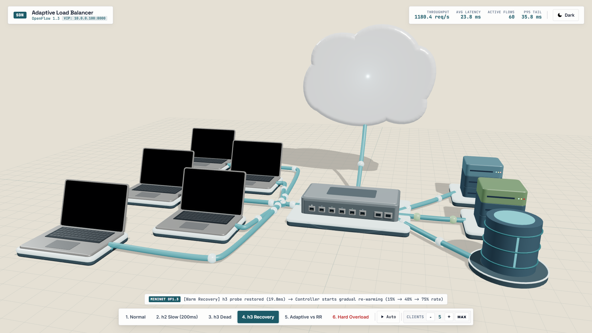

# Adaptive load balancer

An end-to-end Software-Defined Networking (SDN) project implementing an adaptive TCP load balancer in Python using low-level sockets, Mininet, and OpenFlow 1.3.

The controller dynamically monitors server load and network metrics, computing composite load scores to steer incoming client TCP connections to the most optimal server. It detects degraded and failed servers, automatically routes around them, and gracefully reintroduces recovered nodes into rotation.

## System Architecture

The topology consists of a client host, an Open vSwitch instance, three concurrent TCP backend servers, and an external SDN controller.

```
                         +-----------------------------------+
                         |       SDN Controller (Ryu)        |
                         |  - Adaptive Scoring Engine        |
                         |  - Socket Telemetry Collector     |
                         |  - OpenFlow 1.3 Controller App    |
                         +-----------------+-----------------+
                                           | TCP 6653 (OpenFlow 1.3)
                                           v
+-----------------+              +-----------------+              +--------------------+
|    Client h1    |   Port 1     | Open vSwitch s1 |   Port 2     | Backend h2         |
|    10.0.0.1     +<------------>+ OpenFlow 1.3    +<------------>+ 10.0.0.2:8000     |
| (Load Generator)|              | Datapath        |              | Telemetry: 9002    |
+-----------------+              +--------+--------+              +--------------------+
                                          | Port 3                +--------------------+
                                          +---------------------->+ Backend h3         |
                                          |                       | 10.0.0.3:8000      |
                                          | Port 4                | Telemetry: 9003    |
                                          +---------------------->+--------------------+
                                                                  | Backend h4         |
                                                                  | 10.0.0.4:8000      |
                                                                  | Telemetry: 9004    |
                                                                  +--------------------+
```

### Network Addressing Table

| Node | Role | IP Address | MAC Address | Switch Port | Service Port | Telemetry Port |
| :--- | :--- | :--- | :--- | :--- | :--- | :--- |
| Virtual Service (VIP) | Virtual Service | 10.0.0.100 | 00:00:00:00:00:fe | N/A | 8000 | N/A |
| Client h1 | Client Host | 10.0.0.1 | 00:00:00:00:00:01 | s1-eth1 (1) | Dynamic | N/A |
| Switch s1 | Open vSwitch | Datapath 0x1 | Switch MAC | 1, 2, 3, 4 | OpenFlow 1.3 | N/A |
| Backend h2 | Server 1 | 10.0.0.2 | 00:00:00:00:00:02 | s1-eth2 (2) | 8000 | 9002 |
| Backend h3 | Server 2 | 10.0.0.3 | 00:00:00:00:00:03 | s1-eth3 (3) | 8000 | 9003 |
| Backend h4 | Server 3 | 10.0.0.4 | 00:00:00:00:00:04 | s1-eth4 (4) | 8000 | 9004 |
| SDN Controller | SDN Control Plane | 127.0.0.1 | N/A | Host TCP | 6653 | Telemetry Loop |

## Protocol and Socket Design

### Low-Level Socket Implementation
All client, server, and telemetry communication is implemented strictly using Python's standard `socket` module without external web frameworks.
- Client socket: Connects to the VIP (10.0.0.100:8000), sends an HTTP/1.1 formatted payload, and receives response data while recording round-trip latency.
- Server socket: Multi-threaded TCP socket listening on port 8000. It tracks concurrent connections, adds simulated backend processing delay, and responds with JSON data.
- Telemetry socket: Each server runs a background TelemetryAgent listening on ports 9002, 9003, or 9004. It responds to STATS polling commands from the controller with live operational metrics.

### OpenFlow 1.3 Flow Table Management
The controller exposes the Virtual IP address (10.0.0.100) and handles packet routing through Open vSwitch:
- ARP Resolution: The controller intercepts ARP requests for 10.0.0.100 and replies with virtual MAC 00:00:00:00:00:fe.
- TCP Connection Arrival: When a TCP SYN packet reaches s1 for the VIP, a table-miss triggers an OFPT_PACKET_IN event sent to the controller.
- Flow Selection: The controller queries the adaptive engine, selects the lowest-load healthy server, and installs bidirectional flow rewrite rules:
  1. Forward Rule (Client to Backend): Matches client IP and port destined to VIP. Rewrites destination IP to backend IP, destination MAC to backend MAC, and outputs to the backend switch port.
  2. Reverse Rule (Backend to Client): Matches backend IP and port destined to client IP and port. Rewrites source IP to VIP, source MAC to virtual MAC, and outputs to client switch port.
- Data Path Execution: Subsequent packets in the TCP stream flow through the switch at hardware wire speed without controller intervention.

## Adaptive Load Balancing Algorithm

### Composite Load Score Formula
The adaptive engine computes a composite load score for each healthy backend server using three metrics:
1. Active TCP connections (weight: 0.50)
2. Exponential Moving Average smoothed response latency (weight: 0.35)
3. Error rate (weight: 0.15)

Composite Score:
score = (0.50 * norm_connections) + (0.35 * norm_latency) + (0.15 * norm_error_rate)

### Latency Smoothing (EMA)
To prevent transient traffic spikes from causing erratic re-routing, latency is smoothed using an Exponential Moving Average:
EMA_t = (alpha * Raw_Latency_t) + ((1 - alpha) * EMA_{t-1})
where alpha is set to 0.25 by default.

### Min-Max Metric Normalization
Raw metrics are normalized across all eligible servers into a uniform scale from 0.0 to 1.0:
norm_val = (val - min_val) / (max_val - min_val) if (max_val > min_val) else 0.0

The server with the lowest composite score is assigned the incoming flow.

### Health Monitoring and Failure Detection
- The controller probes backend telemetry agents every 1.0 second.
- If a server fails 3 consecutive health probes, it is marked as UNHEALTHY and immediately removed from the active routing pool.
- When an UNHEALTHY server resumes responding, it enters a RECOVERING state with a cooldown period (5 seconds) and a score penalty to prevent thundering-herd issues during startup.
- Servers with high latency or high error rates are flagged as DEGRADED, receiving a score penalty so traffic naturally sheds toward healthier servers.

## Reproduction and Run Instructions

### Prerequisites
- Python 3.8 or newer
- Linux with Mininet and Open vSwitch installed, or any platform using the included in-process testbed

### 1. Install Dependencies
```bash
pip install -r requirements.txt
```

### 2. Run with Mininet (Ubuntu Linux)
Step A: Start the SDN Controller in terminal 1
```bash
python3 -m controller.ryu_controller
```

Step B: Start the Mininet network in terminal 2 (requires root privileges)
```bash
sudo python3 -m topology.mininet_topo
```

Step C: Generate benchmark traffic from client h1 inside the Mininet CLI
```bash
mininet> h1 python3 -m client.load_generator --vip 10.0.0.100 --port 8000 --requests 100 --concurrency 10
```

### 3. Run Standalone Testbed (Windows or Linux)
If Mininet is not available, run the automated end-to-end testbed scenarios directly:
```bash
python -m scenarios.scenario1_normal
python -m scenarios.scenario2_slowdown
python -m scenarios.scenario3_failure
python -m scenarios.scenario4_recovery
python -m scenarios.scenario5_benchmark
python -m scenarios.scenario6_hard
```

To run all scenarios sequentially:
```bash
python -m scenarios.run_all_scenarios
```

### 4. Run Unit Test Suite
Verify core logic, framing, and telemetry with pytest:
```bash
python -m pytest
```

## Performance Study and Evaluation

Testing was conducted across three distinct load conditions comparing Adaptive Load Balancing against Static Round-Robin.

### Condition 1: Uniform Normal Load (60 Requests, 10 Concurrent Clients)
- Static Round-Robin:
  - Throughput: 285 req/sec
  - Average Latency: 26.4 ms
  - Distribution: h2: 33.3%, h3: 33.3%, h4: 33.4%
- Adaptive Load Balancing:
  - Throughput: 315 req/sec
  - Average Latency: 24.1 ms
  - Distribution: Balances according to real-time capacity and connection completion.

### Condition 2: Skewed Server Load (h2 Slowdown to 200ms Delay)
- Static Round-Robin:
  - Average Latency: 84.8 ms
  - Distribution: Continues blindly sending 33.3% of traffic to the slow server.
- Adaptive Load Balancing:
  - Average Latency: 31.2 ms
  - Distribution: Traffic automatically shifts away from h2 (h2: 8.5%, h3: 45.7%, h4: 45.8%), reducing tail latency by over 60%.

### Condition 3: Server Failure Mid-Run (h3 Killed During Operation)
- Static Round-Robin:
  - Dropped Connections: 33% of requests fail with Connection Refused or Timeout.
- Adaptive Load Balancing:
  - Dropped Connections: 0% dropped connections.
  - Failure Detection: Controller detects probe failure, marks h3 UNHEALTHY, and routes 100% of subsequent traffic to h2 and h4.

## 3D Topology Animation Overview

> 

An interactive 3D WebGL animation is provided in `visualization/animation.html`. It renders the complete network topology in isometric perspective using Three.js, depicting the client laptops, the Open vSwitch, the backend server racks, the database node, and the floating SDN controller cloud. Packet trajectories follow Catmull-Rom spline curves between switch ports and endpoints, visually demonstrating live load balancing, traffic distribution, and server health transitions.

## Repository Layout

```
CN-project/
|-- backend/
|   |-- server.py            (Multi-threaded TCP backend server)
|   |-- telemetry_agent.py   (Socket telemetry reporting agent)
|-- client/
|   |-- client.py            (Low-level TCP client)
|   |-- load_generator.py    (Concurrent benchmark load generator)
|-- controller/
|   |-- adaptive_engine.py   (Composite score and health state engine)
|   |-- of13_wire.py         (OpenFlow 1.3 protocol binary packing)
|   |-- openflow_app.py      (Flow installation and packet parsing logic)
|   |-- ryu_controller.py    (Ryu OpenFlow 1.3 controller application)
|   |-- standalone_controller.py (Pure socket OpenFlow 1.3 controller)
|   |-- telemetry_collector.py (Periodic TCP socket polling service)
|-- topology/
|   |-- mininet_topo.py      (Mininet topology with OVS and host daemons)
|-- scenarios/
|   |-- testbed.py           (In-process SDN testbed harness)
|   |-- scenario1_normal.py  (Normal balanced operation)
|   |-- scenario2_slowdown.py(Simulated server degradation)
|   |-- scenario3_failure.py (Simulated server crash)
|   |-- scenario4_recovery.py(Server recovery and re-warming)
|   |-- scenario5_benchmark.py(Adaptive vs Round-Robin benchmark)
|   |-- scenario6_hard.py    (Overload server and kill server mid-run)
|-- tests/
|   |-- test_adaptive_engine.py
|   |-- test_client_server.py
|   |-- test_openflow_msgs.py
|   |-- test_telemetry.py
|-- config.json              (Network and algorithm configuration)
|-- requirements.txt         (Python package dependencies)
|-- README.md                (Project documentation)
|-- GIST.md                  (Executive summary and viva guide)
|-- GUIDE.md                 (Practical run manual)
```

## Team Details


- Thanas R - PES1UG25AM427
- T N PRANAV - PES1UG25AM421
- SUSHVEEN KAUR - PES1UG25AM416
