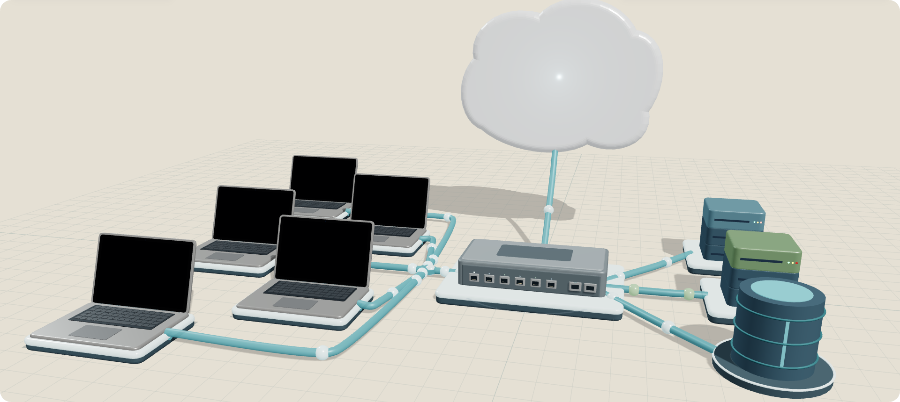
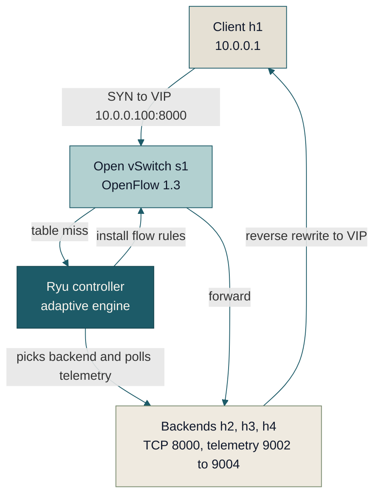

<h1 align="center">Adaptive TCP Load Balancer</h1>

<p align="center">
an SDN data plane that reads backend health before it routes
</p>

<p align="center">
  
  
  
  
  
</p>

<p align="center">
  <a href="#overview">Overview</a> &nbsp;|&nbsp;
  <a href="#how-it-works">How it works</a> &nbsp;|&nbsp;
  <a href="#scoring">Scoring</a> &nbsp;|&nbsp;
  <a href="#quick-start">Quick start</a> &nbsp;|&nbsp;
  <a href="#scenarios">Scenarios</a> &nbsp;|&nbsp;
  <a href="#results">Results</a> &nbsp;|&nbsp;
  <a href="#documentation">Docs</a>
</p>

<p align="center">
  
</p>

## Overview

Round-robin keeps sending traffic to a server that is already slow, or worse, already dead. This project replaces that fixed policy with an OpenFlow 1.3 controller that polls every backend over a plain TCP socket, scores it on live telemetry, and installs a flow only after it picks a winner.

The controller is the control plane. Open vSwitch is the data plane. Once the two rewrite rules are in place, packets move at switch speed and the controller stays out of the way.

### Network addressing

The data plane uses one `/24` subnet, a single virtual service address, and a dedicated telemetry port for each backend.

| Node | Role | IP address | MAC address | Switch port | Service | Telemetry |
| :--- | :--- | :--- | :--- | :--- | :--- | :--- |
| Virtual service | VIP seen by clients | `10.0.0.100` | `00:00:00:00:00:fe` | N/A | `8000` | N/A |
| Client `h1` | Traffic source | `10.0.0.1` | `00:00:00:00:00:01` | `1` | Dynamic | N/A |
| Switch `s1` | Open vSwitch datapath | N/A | N/A | `1` to `4` | OpenFlow 1.3 | N/A |
| Backend `h2` | Server 1 | `10.0.0.2` | `00:00:00:00:00:02` | `2` | `8000` | `9002` |
| Backend `h3` | Server 2 | `10.0.0.3` | `00:00:00:00:00:03` | `3` | `8000` | `9003` |
| Backend `h4` | Server 3 | `10.0.0.4` | `00:00:00:00:00:04` | `4` | `8000` | `9004` |
| Controller | Control plane | `127.0.0.1` | N/A | Host TCP | `6653` | Collector loop |

The standalone testbed uses the same design on localhost. It prefers the VIP on `127.0.0.1:8000` and backends on ports `8002` to `8004`, and falls back to free local ports when a port is already in use.

## How it works



The request lifecycle in five steps:

1. The client asks for the VIP. The controller answers ARP with the virtual MAC.
2. The first SYN misses the flow table and reaches the controller as a packet-in event.
3. The engine normalizes the latest metrics, applies health penalties, and picks the lowest score.
4. The controller installs two rules at priority 100, one for each direction.
5. Later packets in the stream are forwarded by the switch. The controller is no longer involved.

| Direction | Match | Rewrite | Output |
| :--- | :--- | :--- | :--- |
| Client to backend | Client IP and port to VIP `:8000` | Destination IP and MAC set to the chosen backend | Backend switch port |
| Backend to client | Backend IP and port to client IP and port | Source IP and MAC set to VIP and virtual MAC | Client port `1` |

The reverse rewrite is what makes the VIP transparent. Without it, the client would see replies from `10.0.0.2` for a socket that was opened to `10.0.0.100`.

## Scoring

Three signals, one score. Each metric is min-max normalized across the eligible backends, then weighted. The engine also counts flows it has just assigned, so a burst does not stack on one backend before the next telemetry poll. Latency differences under 5 ms are treated as noise.

| Metric | Weight | Why it matters |
| :--- | :--- | :--- |
| Active connections | `0.50` | Current queue pressure on the backend |
| Smoothed latency | `0.35` | Early warning that a backend is slowing down |
| Error rate | `0.15` | Failed or timed out requests |

```text
score = 0.50 * norm(connections) + 0.35 * norm(latency) + 0.15 * norm(errors)

EMA   = 0.25 * current_sample + 0.75 * previous_EMA
```

Latency is smoothed with an exponential moving average so a single spike does not trigger route thrashing. The backend with the lowest score receives the next flow.

### Health states

| State | Trigger | Routing effect |
| :--- | :--- | :--- |
| Healthy | Normal telemetry | Fully eligible, no penalty |
| Degraded | Error rate of 25% or more, or latency of 150 ms or more | Eligible, score penalty `+0.20` |
| Unhealthy | 3 failed probes in a row | Excluded from new flows |
| Recovering | First successful probe after a failure | Eligible, penalty `+0.35` for a 5 second cooldown |

When no backend is healthy, new connections are rejected instead of being sent into a black hole.

## Quick start

You need Python 3.8 or newer. Mininet on Ubuntu 20.04 or later is optional but recommended for the full switch demo.

```bash
pip install -r requirements.txt
```

### Full Mininet run

```bash
# Terminal 1: start the controller
python3 -m controller.standalone_controller

# Terminal 2: start the topology as root
sudo python3 -m topology.mininet_topo

# Mininet CLI: send traffic from h1
mininet> h1 python3 -m client.load_generator --vip 10.0.0.100 --port 8000 --requests 100 --concurrency 10
```

The standalone controller has no external OpenFlow dependency. If Ryu is installed, `python3 -m controller.ryu_controller` provides the same behavior.

To inspect the installed rules while traffic is flowing:

```bash
sudo ovs-ofctl -O OpenFlow13 dump-flows s1
```

### Standalone testbed

No Mininet, no root, works on Windows, macOS, and Linux:

```bash
python -m scenarios.run_all_scenarios
```

Or use the interactive Windows control center:

```bash
python run_windows.py
```

### Unit tests

```bash
python -m pytest
```

## Scenarios

Six automated demos exercise the controller without a real network namespace.

| # | Scenario | Command |
| :--- | :--- | :--- |
| 1 | Normal traffic across all three backends | `python -m scenarios.scenario1_normal` |
| 2 | h2 slowed to 200 ms, traffic sheds to h3 and h4 | `python -m scenarios.scenario2_slowdown` |
| 3 | h3 killed mid-run, controller excludes it | `python -m scenarios.scenario3_failure` |
| 4 | h3 recovers and is re-warmed gradually | `python -m scenarios.scenario4_recovery` |
| 5 | Adaptive compared with static round-robin | `python -m scenarios.scenario5_benchmark` |
| 6 | h2 overloaded and h3 killed at the same time | `python -m scenarios.scenario6_hard` |

Results are written to `logs/`, including `all_scenarios.log` and `scenario_results.json`.

## Results

Measured in Mininet with 10 concurrent clients.

| Test | Round-robin | Adaptive | Change |
| :--- | :--- | :--- | :--- |
| Uniform load, 60 requests | 285 req/s | 315 req/s | `+10.5%` throughput |
| h2 slowed to 200 ms | 84.8 ms average | 31.2 ms average | `-63.2%` latency |
| h3 killed mid-run | 33% dropped | 0% dropped | Automatic failover |
| Traffic sent to slow h2 | 33.3% | 8.5% | Load sheds away from the degraded node |

The last row is the point of the whole system: the slow backend is still reachable, but it no longer receives an equal share of new connections.

## Visualizer

Open `visualization/animation.html` in any modern browser. The scene is built with Three.js and shows the client laptops, the switch, the backend racks, and the controller cloud on a beige isometric floor.

Scenario buttons cover normal load, h2 slowdown, h3 failure, h3 recovery, adaptive versus round-robin, and the hard overload case. Packets reroute as health state changes, and the top bar tracks throughput, average latency, active flows, and p95 tail latency.

## Documentation

| Document | What it covers |
| :--- | :--- |
| [Software requirements](docs/SRS_Adaptive_Load_Balancer.pdf) | Requirements, design, and constraints |
| [Test plan](docs/IEEE%20829%20Test%20Plan_ALB.pdf) | IEEE 829 test cases and coverage |
| [Presentation](docs/miniproject_presentation.pdf) | Project slides in PDF, also as [PPTX](docs/miniproject_presentation.pptx) |
| [Configuration](config.json) | Addresses, weights, timeouts, and health thresholds |

## Repository layout

```text
backend/        TCP server and telemetry agent
client/         TCP client and concurrent load generator
controller/     Adaptive engine, OpenFlow 1.3 app, telemetry collector
topology/       Mininet topology with Open vSwitch
scenarios/      Six automated demonstrations and the testbed harness
tests/          Pytest suite for engine, sockets, OpenFlow, and telemetry
visualization/  Three.js animation and terminal renderer
docs/           SRS, test plan, slides, and topology screenshot
```

## Team

| Name | SRN |
| :--- | :--- |
| Thanas R | PES1UG25AM427 |
| T N Pranav | PES1UG25AM421 |
| Sushveen Kaur | PES1UG25AM416 |

Computer Networks mini project, Team 5, G section, CSE(AIML) Dept, PES University
